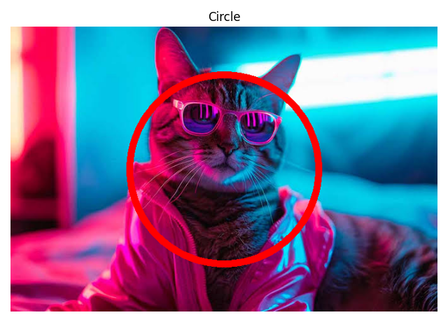
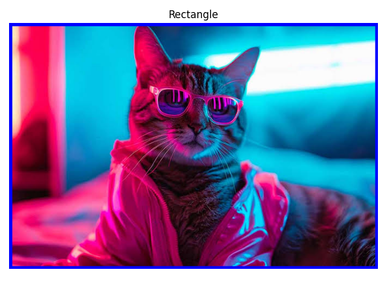
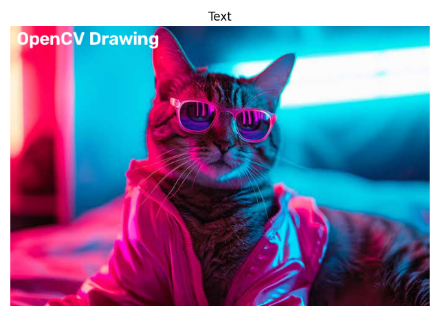
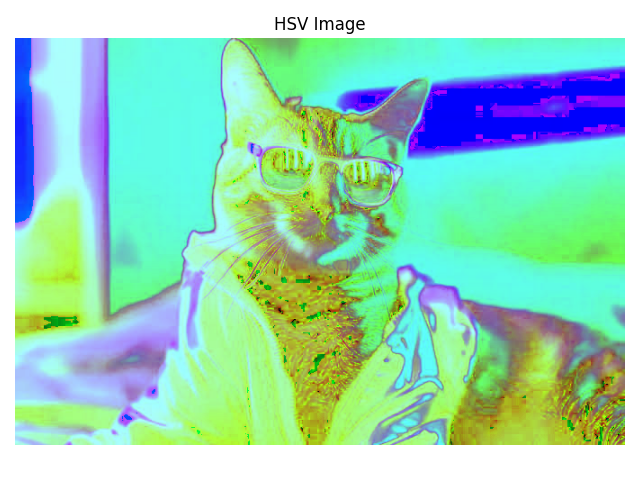
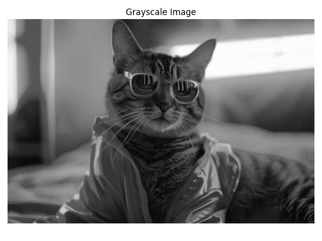
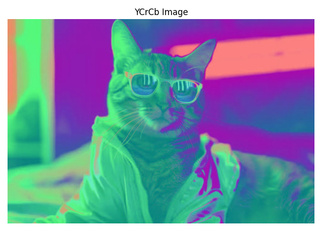
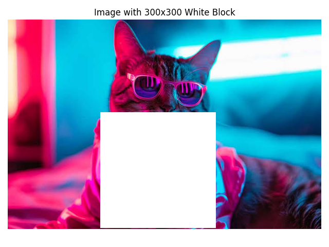
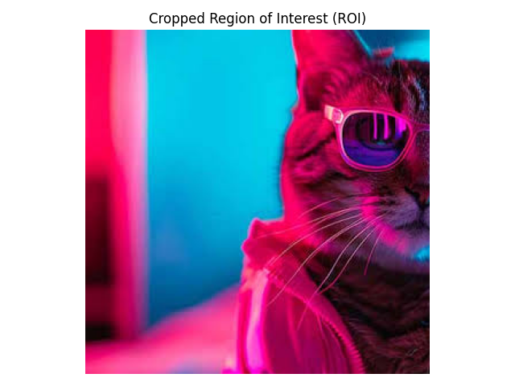
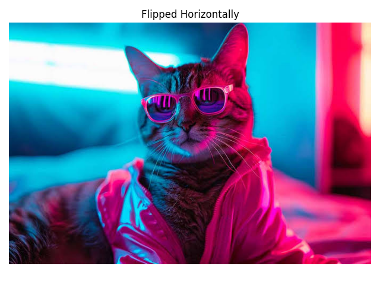
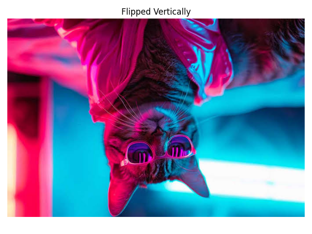

# Experiment 1: Image Handling and Pixel Transformations Using OpenCV

**Name:** Mithik Jain  
**Register Number:** 212224240087  

---

## Aim:
To write a Python program using OpenCV and Matplotlib to perform basic image handling and pixel transformations, including reading, displaying, drawing geometric shapes, adding text, converting between color spaces, manipulating pixels, resizing, cropping, flipping, and saving the final modified image.

---

## Algorithm:
- **Step 1: Read and Display an Image**
  - Import the necessary OpenCV (`cv2`) and Matplotlib (`matplotlib.pyplot`) libraries.
  - Read an image from the local directory using `cv2.imread()`.
  - Convert the image from BGR to RGB color space using `cv2.cvtColor()`.
  - Display the original image using Matplotlib (`plt.imshow()`).
- **Step 2: Draw Shapes and Add Text**
  - Draw a line from the top-left to the bottom-right of the image using `cv2.line()`.
  - Draw a circle at the center of the image using `cv2.circle()`.
  - Draw a rectangle around the whole image using `cv2.rectangle()`.
  - Add the text `"OpenCV Drawing"` at the top-left corner of the image using `cv2.putText()`.
- **Step 3: Color Space Conversion**
  - Convert the RGB image to HSV and display it.
  - Convert the RGB image to Grayscale and display it.
  - Convert the RGB image to YCrCb and display it.
  - Convert the HSV image back to RGB and display it.
- **Step 4: Pixel Manipulation**
  - Access and print the pixel value at coordinates $(100, 100)$.
  - Change the pixel at coordinates $(200, 200)$ to white `[255, 255, 255]`.
  - Modify a $300 \times 300$ region of the image to white.
  - Display the modified image using Matplotlib.
- **Step 5: Image Resizing**
  - Read the original image from the local directory.
  - Resize the image to half its original width and height using `cv2.resize()`.
  - Display the resized image using Matplotlib.
- **Step 6: Image Cropping**
  - Read the original image from the local directory.
  - Extract a $300 \times 300$ region of interest (ROI) starting at coordinates $(50, 50)$.
  - Display the cropped image using Matplotlib.
- **Step 7: Image Flipping**
  - Flip the original image horizontally using `cv2.flip(image, 1)`.
  - Flip the original image vertically using `cv2.flip(image, 0)`.
  - Display both horizontally and vertically flipped images using Matplotlib.
- **Step 8: Save the Final Modified Image**
  - Save the modified image into the local directory using `cv2.imwrite()`.
  - Verify that the image has been saved successfully.

---

## Program:
```python
# ==============================================================================
# Name: Mithik Jain
# Reg No: 212224240087
# Experiment 1: Image Handling and Pixel Transformations Using OpenCV
# ==============================================================================

import cv2
import matplotlib.pyplot as plt

# ------------------------------------------------------------------------------
# Step 1: Read and Display an Image
# ------------------------------------------------------------------------------
# Read the image using OpenCV
img = cv2.imread('Qno. 1.jpg', cv2.IMREAD_COLOR)

# Convert BGR (OpenCV's default) to RGB (Matplotlib's expected color order)
img_rgb = cv2.cvtColor(img, cv2.COLOR_BGR2RGB)

# Display the original image using Matplotlib
plt.imshow(img_rgb)
plt.title("Original Image")
plt.axis('off')
plt.show()

# ------------------------------------------------------------------------------
# Step 2: Draw Shapes and Add Text
# ------------------------------------------------------------------------------
# Reload fresh image and convert to RGB
image = cv2.imread('Qno. 1.jpg')
img_rgb = cv2.cvtColor(image, cv2.COLOR_BGR2RGB)
h, w, c = img_rgb.shape

# 1. Draw a line from top-left to bottom-right
line_img = cv2.line(img_rgb.copy(), (0, 0), (w, h), (255, 0, 0), 2)
plt.imshow(line_img)
plt.title("Image with Line")
plt.axis('off')
plt.show()

# 2. Draw a circle at the center of the image
center_x, center_y = w // 2, h // 2
circle_img = cv2.circle(img_rgb.copy(), (center_x, center_y), 150, (255, 0, 0), 10)
plt.imshow(circle_img)
plt.title("Image with Circle")
plt.axis('off')
plt.show()

# 3. Draw a rectangle around the whole image
rectangle_img = cv2.rectangle(img_rgb.copy(), (0, 0), (w, h), (0, 0, 255), 10)
plt.imshow(rectangle_img)
plt.title("Image with Rectangle")
plt.axis('off')
plt.show()

# 4. Add the text "OpenCV Drawing" at top-left corner
text_img = cv2.putText(img_rgb.copy(), "OpenCV Drawing", (10, 30), cv2.FONT_HERSHEY_SIMPLEX, 1, (255, 255, 255), 3)
plt.imshow(text_img)
plt.title("Image with Text")
plt.axis('off')
plt.show()

# ------------------------------------------------------------------------------
# Step 3: Color Space Conversion
# ------------------------------------------------------------------------------
image = cv2.imread('Qno. 1.jpg')
image_rgb = cv2.cvtColor(image, cv2.COLOR_BGR2RGB)

# 1. Convert RGB to HSV and display it
image_hsv = cv2.cvtColor(image_rgb, cv2.COLOR_RGB2HSV)
plt.imshow(image_hsv)
plt.title("HSV Image")
plt.axis("off")
plt.show()

# 2. Convert RGB to Grayscale and display it
image_gray = cv2.cvtColor(image_rgb, cv2.COLOR_RGB2GRAY)
plt.imshow(image_gray, cmap='gray')
plt.title("Grayscale Image")
plt.axis("off")
plt.show()

# 3. Convert RGB to YCrCb and display it
image_ycrcb = cv2.cvtColor(image_rgb, cv2.COLOR_RGB2YCrCb)
plt.imshow(image_ycrcb)
plt.title("YCrCb Image")
plt.axis("off")
plt.show()

# 4. Convert HSV back to RGB and display it
image_hsv_to_rgb = cv2.cvtColor(image_hsv, cv2.COLOR_HSV2RGB)
plt.imshow(image_hsv_to_rgb)
plt.title("HSV to RGB Image")
plt.axis("off")
plt.show()

# ------------------------------------------------------------------------------
# Step 4: Pixel Manipulation
# ------------------------------------------------------------------------------
image = cv2.imread('Qno. 1.jpg')

# 1. Access and print pixel value at coordinates (100, 100)
pixel_val = image[100, 100]
print(f"Pixel value at (100, 100): {pixel_val}")

# 2. Change pixel at (200, 200) to white
image[200, 200] = [255, 255, 255]

# 3. Modify a 300x300 region of the image to white starting from (200, 200)
image[200:450, 200:450] = [255, 255, 255]

# 4. Display the modified image
image_rgb = cv2.cvtColor(image, cv2.COLOR_BGR2RGB)
plt.imshow(image_rgb)
plt.title("Image with 300x300 White Block")
plt.axis("off")
plt.show()

# ------------------------------------------------------------------------------
# Step 5: Image Resizing
# ------------------------------------------------------------------------------
image = cv2.imread('Qno. 1.jpg')
h, w, c = image.shape

# Resize image to half its original width and height
resized_image = cv2.resize(image, (w // 2, h // 2))
resized_image_rgb = cv2.cvtColor(resized_image, cv2.COLOR_BGR2RGB)

plt.imshow(resized_image_rgb)
plt.title("Resized Image (Half Size)")
plt.axis("off")
plt.show()

# ------------------------------------------------------------------------------
# Step 6: Image Cropping
# ------------------------------------------------------------------------------
image = cv2.imread('Qno. 1.jpg')

# Crop a 300x300 region starting from (50, 50)
roi = image[50:350, 50:350]
roi_rgb = cv2.cvtColor(roi, cv2.COLOR_BGR2RGB)

plt.imshow(roi_rgb)
plt.title("Cropped Region of Interest (ROI)")
plt.axis("off")
plt.show()

# ------------------------------------------------------------------------------
# Step 7: Image Flipping
# ------------------------------------------------------------------------------
image = cv2.imread('Qno. 1.jpg')

# 1. Flip horizontally
flipped_horizontally = cv2.flip(image, 1)
flipped_horizontally_rgb = cv2.cvtColor(flipped_horizontally, cv2.COLOR_BGR2RGB)

plt.imshow(flipped_horizontally_rgb)
plt.title("Flipped Horizontally")
plt.axis("off")
plt.show()

# 2. Flip vertically
flipped_vertically = cv2.flip(image, 0)
flipped_vertically_rgb = cv2.cvtColor(flipped_vertically, cv2.COLOR_BGR2RGB)

plt.imshow(flipped_vertically_rgb)
plt.title("Flipped Vertically")
plt.axis("off")
plt.show()

# ------------------------------------------------------------------------------
# Step 8: Save the Final Modified Image
# ------------------------------------------------------------------------------
cv2.imwrite('final_modified_image.jpg', flipped_vertically)
print("Saved modified image to 'final_modified_image.jpg'")
```

---

## Output:

### Step 1: Read and Display an Image
#### Original Image


---

### Step 2: Draw Shapes and Add Text

| Line | Circle |
| :---: | :---: |
|  |  |
| **Line** | **Circle** |

| Rectangle | Text |
| :---: | :---: |
|  |  |
| **Rectangle** | **Text** |

---

### Step 3: Color Space Conversion

| HSV Image | Grayscale Image |
| :---: | :---: |
|  |  |
| **HSV Image** | **Grayscale Image** |

| YCrCb Image | HSV to RGB Image |
| :---: | :---: |
|  |  |
| **YCrCb Image** | **HSV to RGB Image** |

---

### Step 4: Pixel Manipulation

```text
Pixel value at (100, 100): [223 177 229]
```

#### Pixel Manipulation


---

### Step 5: Image Resizing

#### Resized Image


---

### Step 6: Image Cropping

#### Cropped ROI


---

### Step 7: Image Flipping

| Horizontally Flipped | Vertically Flipped |
| :---: | :---: |
|  |  |
| **Flipped Horizontally** | **Flipped Vertically** |

---

### Step 8: Save the Final Modified Image

The modified image is successfully saved as `final_modified_image.jpg` in the local directory.

---

## Result:
Thus, the Python program to perform basic image handling and pixel transformations using OpenCV was successfully implemented and executed.

